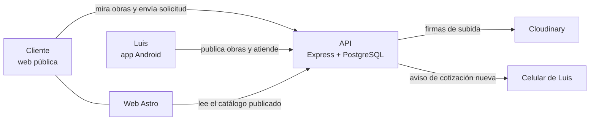

# SEIMA Servicios Generales

Portafolio, catálogo y cotizador de **Luis Rodríguez**. Drywall, enchapado, electricidad, melamina y pintura en Lima y provincias.

Luis enseña la obra desde el celular. El cliente ve cómo quedó un espacio parecido al suyo, arma una solicitud con opciones y Luis la atiende desde el teléfono. La web no es una landing de tres tarjetas: es el catálogo de las obras y el camino para pedir una.

> Construimos tu espacio, capa por capa.

| | |
|---|---|
| **Para quien pide una obra** | Mira proyectos reales, filtra por ambiente y deja los datos ordenados. La respuesta llega por WhatsApp. |
| **Para Luis** | Publica fotos y videos, elige la comparación y la portada, y atiende cada cotización desde una app Android. |
| **Lo que no es** | Un panel web. No hay login en el sitio público. El panel de Luis es la app. |

El canal de hoy es TikTok, [@seima.drywall](https://www.tiktok.com/@seima.drywall). Esta web es la versión que se puede mostrar en una visita: seria, compartible por WhatsApp y usable con datos móviles.

## Cómo circula el trabajo



La web y la app nunca tocan la base de datos. La API decide, firma y registra. Las fotos y los videos viajan directo a Cloudinary; en PostgreSQL solo queda el identificador.

### El cliente, en la web

1. Entra por la portada. Una casa se arma por capas y los ambientes llevan al catálogo.
2. Filtra obras (cocinas, baños, departamentos, melamina, techos, cocheras, remodelaciones, locales).
3. Abre una ficha: comparación antes/después, la historia por etapas y, si hay video, un visor con sonido.
4. Arma la cotización en seis pasos. Los servicios y las preguntas salen de la base, no están escritos en la página.
5. Envía la solicitud con el botón **Enviar solicitud**. Acepta el tratamiento de datos y puede dejar fotos del espacio.

WhatsApp es el canal de respuesta, no el formulario. Si falta el número, el botón sale como un placeholder, no con un teléfono inventado.

### Luis, en el celular

La app se llama **SEIMA**, paquete `pe.seima.app`, y habla de tú. Una cosa por pantalla, botones grandes, palabras simples: Antes, Durante, Después, Portada, Publicar, Ocultar.

Para publicar una obra hace falta una comparación, al menos un archivo en cada etapa y una portada de dos fotos (antes y después). Un video de más de un minuto se recorta en el teléfono. Los videos, por defecto, esperan Wi-Fi y pueden seguir subiendo con la app cerrada.

Cuando llega una cotización, el aviso abre esa solicitud. Desde ahí se escribe por WhatsApp, se llama o se cambia el estado: nueva, ya contactada, cerrada o descartada.

## Las tres partes

| | `web/` | `api/` | `app/` |
|---|---|---|---|
| Qué es | Sitio público | Dueña de los datos | Panel de Luis |
| Stack | Astro 7, GSAP, Lenis. React solo en el cotizador | Express 5, TypeScript, TypeORM, PostgreSQL, Zod | Flutter, Riverpod, solo Android |
| Quién entra | Nadie inicia sesión | Firma JWT para la app | Usuario `luis`, sesión larga, huella opcional |
| Dónde vive en pruebas | Por definir al publicar | Render | El teléfono de Luis |

```text
seima_web/
├── web/     sitio público
├── api/     backend
├── app/     app Android
├── docs/    brief, modelo de datos, plan de la app y fuentes
├── STATE.md memoria viva: qué hay, qué se decidió y por qué
└── CLAUDE.md reglas para quien construya encima
```

Se trabaja en la rama `staging`. `main` es la estable. Un commit toca una sola parte y lleva el prefijo `[web]`, `[api]`, `[app]`, `[docs]` o `[repo]`.

## La web, página por página

| Ruta | Qué ve la persona |
|---|---|
| `/` | La casa que se construye, la pared por oficios y una galería de obras |
| `/proyectos` | Catálogo con filtros. Si no hay obras publicadas, lo dice y muestra las de prueba |
| `/proyectos/[slug]` | Ficha con comparación, galería por etapa y vista previa propia al compartir |
| `/cotizador` | Seis pasos. Acepta `?categoria=`, `?proyecto=` y `?cliente=empresa` |
| `/empresas` | Propuesta para obras de escala: locales, varios departamentos |
| `/privacidad` | Borrador del tratamiento de datos. Todavía tiene huecos marcados |
| `404` | «Esta página sigue en obra» |

La dirección visual mezcla oscuro (`#0E0E0E`) en las secciones de impacto y blanco neutro en el catálogo y el cotizador. El rojo es `#E0283C`. Los títulos van en Archivo, ancha y pesada. Las fotos de obra, que no son de estudio, comparten el mismo recorte y pasan de negro y rojo a color al tocarlas.

El movimiento (casa, galería, textos) lo hace GSAP. El cotizador, que es la única isla de React, usa Motion. No se mezclan en el mismo componente. Quien pide reducir el movimiento ve el mismo contenido, quieto.

## La API, en una frase por capa

Cada área vive en `api/src/modules/<nombre>/`: entidad, repositorio, servicio, controlador y rutas. Solo el repositorio habla con TypeORM. La base cambia únicamente por migraciones. `synchronize` está apagado.

Todo entra por `/api/v1`.

**Público, sin sesión**

- `GET /categories` y `GET /projects` — solo obras publicadas
- `GET /projects/:slug` — ficha, medios y comparación. Un borrador o una obra oculta responden 404
- `GET /quote-form` — servicios y preguntas del cotizador
- `POST /quotes` — guarda la solicitud como filas: servicios, respuestas, fotos y notas
- `POST /uploads/quote-photos/signature` — firma para que el navegador suba las fotos directo a Cloudinary

**De la app, con sesión**

- Entrar, renovar la sesión, salir y cambiar la contraseña
- Crear y editar obras, subir medios, elegir comparación y portada, publicar u ocultar
- Listar cotizaciones, ver el detalle y cambiar el estado
- Registrar el celular para los avisos

Los entornos son `dev`, `qa`, `pd` y `test`. Cada uno tiene su archivo `.env.<entorno>` (fuera de git) y su `.example`. En la máquina de desarrollo, `npm run dev` dentro de `api/` lee `.env` si no existe `.env.dev`.

El detalle de comandos, migraciones y pruebas está en [`api/README.md`](api/README.md).

## Cómo correrlo

Hace falta Node 22.23.4 o mayor y PostgreSQL 13 o mayor.

```bash
cd api
npm install
npm run migration:run
npm run seed:categories
npm run seed:admin
npm run dev
```

```bash
cd web
npm install
npm run dev
```

La web queda en `http://localhost:4321/` y la API en `http://localhost:4000/api/v1`. En `web/.env`, `PUBLIC_API_URL` lleva el prefijo `/api/v1`.

```bash
cd app
flutter pub get
flutter run
```

`API_URL` en `app/.env` apunta a esa API. En el emulador es `http://10.0.2.2:4000/api/v1`. En un celular real, la IP de la computadora. Los pasos de Firebase y la clave de desarrollo están en [`app/README.md`](app/README.md).

## Lo que se puede afirmar

Las obras, las fotos y las cifras que aún no existen se marcan como `[DATO REAL]` o `[FOTO REAL]`. No hay testimonios inventados ni fotos de obra generadas. Si la API no tiene obras publicadas, el catálogo muestra siete proyectos de prueba y lo dice en la página.

Los secretos (base de datos, Cloudinary, JWT, Firebase, el número de WhatsApp) viven solo en archivos `.env`. No van al repositorio. Tampoco van `google-services.json` ni la cuenta de servicio de Firebase.

## Estado, en corto

La web lee el catálogo desde la API, el cotizador guarda la solicitud y la app ya publica obras y lista cotizaciones. Sigue pendiente probar en un Android real el aviso y la subida con la app cerrada, ver un par vertical publicado en el navegador, y desplegar la API de producción con sus migraciones.

El contenido que solo Luis puede dar (número de WhatsApp, fotos de obras, cifras, testimonios con permiso) sigue marcado en el sitio. La lista viva de pendientes está en [`STATE.md`](STATE.md).

## Dónde leer más

| Documento | Para qué abrirlo |
|---|---|
| [`docs/brief.md`](docs/brief.md) | Decisiones de negocio y de producto |
| [`STATE.md`](STATE.md) | Qué está construido hoy, el historial y las lecciones |
| [`CLAUDE.md`](CLAUDE.md) | Reglas de arquitectura, contenido y commits |
| [`docs/modelo-datos.md`](docs/modelo-datos.md) | Fotos, videos, comparación y portada |
| [`docs/plan-app-movil.md`](docs/plan-app-movil.md) | Plan, fases y reglas de la app |
| [`api/README.md`](api/README.md) | Entornos, migraciones, semillas y endpoints |
| [`app/README.md`](app/README.md) | Cómo correr la app y de dónde salen las claves |
